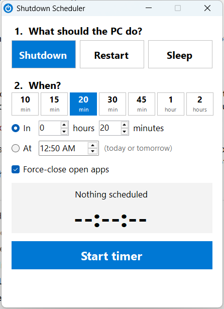
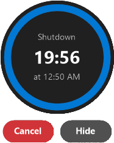

# Shutdown Scheduler

A tiny, no-fuss Windows app to **shut down, restart, or sleep your PC after a timer**. Pick what to do, tap a time, press Start. That's it.

<p align="center">
  
  &nbsp;&nbsp;&nbsp;
  
</p>

## Features

- **Two steps:** choose *Shutdown*, *Restart* or *Sleep*, then choose when.
- **One-tap presets:** 10, 15, 20, 30, 45 minutes, 1 hour, 2 hours. 20 minutes is selected by default.
- **Custom time:** "In X hours Y minutes", or "At 10:30 PM". An "At" time that has already passed today means tomorrow.
- **Floating countdown:** when the timer starts, the window minimizes and a round countdown appears in the top-right corner.
  - **Cancel** stops the schedule.
  - **Hide** tucks the countdown away. It keeps running, and you can bring it back from the tray icon near the clock.
  - Drag the bubble to move it, or click it to open the main window.
  - The ring empties as time runs out and turns red in the last minute. A hidden bubble pops back up then, as a warning.
- **Unsaved work, your choice:**
  - *Force-close open apps* is **on** by default, so the PC really turns off even if an app is stuck.
  - Turn it off and Windows lets apps with unsaved work ask you first.
- **No Windows sign-out pop-ups:** the app runs its own countdown and only tells Windows at the very end.
- **Closing is safe:** while a timer is running, the ✕ button keeps the app in the tray. Use the tray icon's **Exit** to quit, which cancels the timer.
- **Lightweight:** a single small `.exe` with nothing to install. It uses only what ships with Windows.

## Requirements

Windows 10 or 11. .NET Framework 4.x is already built in.

## Getting started

1. Download or clone this repository.
2. Double-click **`build.bat`**. This creates `ShutdownScheduler.exe` using the C# compiler included with Windows.
3. Double-click **`ShutdownScheduler.exe`** to run it.

To get a desktop shortcut, right-click `ShutdownScheduler.exe` → **Show more options** → **Send to** → **Desktop (create shortcut)**.

## How to use

| Step | What to do |
|------|------------|
| 1 | Click **Shutdown**, **Restart** or **Sleep**. |
| 2 | Tap a preset (e.g. **30 min**), or set your own time. |
| 3 | Press **Start timer**. |
| Cancel | Click **Cancel** on the floating countdown, or right-click the tray icon → **Cancel schedule**. |

## How it works

| Part | Detail |
|------|--------|
| Shutdown / Restart | `shutdown /s /t 0` or `/r /t 0` runs at zero, plus `/f` when *Force-close* is on. Using `/t 0` means Windows has no timer of its own, so it never shows a "You're about to be signed out" notification. |
| Sleep | `rundll32 powrprof.dll,SetSuspendState` runs at zero. |
| Countdown | The app has to keep running (minimized or in the tray is fine). Exiting the app cancels the schedule. |

## Testing safely

Run the app with `--dry-run` and it never shuts anything down. Commands are written to `%TEMP%\ShutdownScheduler-dryrun.log` instead.

```bat
ShutdownScheduler.exe --dry-run
```

For quick tests, set `SDS_TEST_SECS`. In dry-run mode only, this overrides the chosen time:

```bat
set SDS_TEST_SECS=70
ShutdownScheduler.exe --dry-run
```

## Project layout

```
ShutdownScheduler.cs   all of the app (WinForms, C# 5)
build.bat              one-click build with the built-in csc.exe
docs/                  screenshots
```

## License

[MIT](LICENSE)
